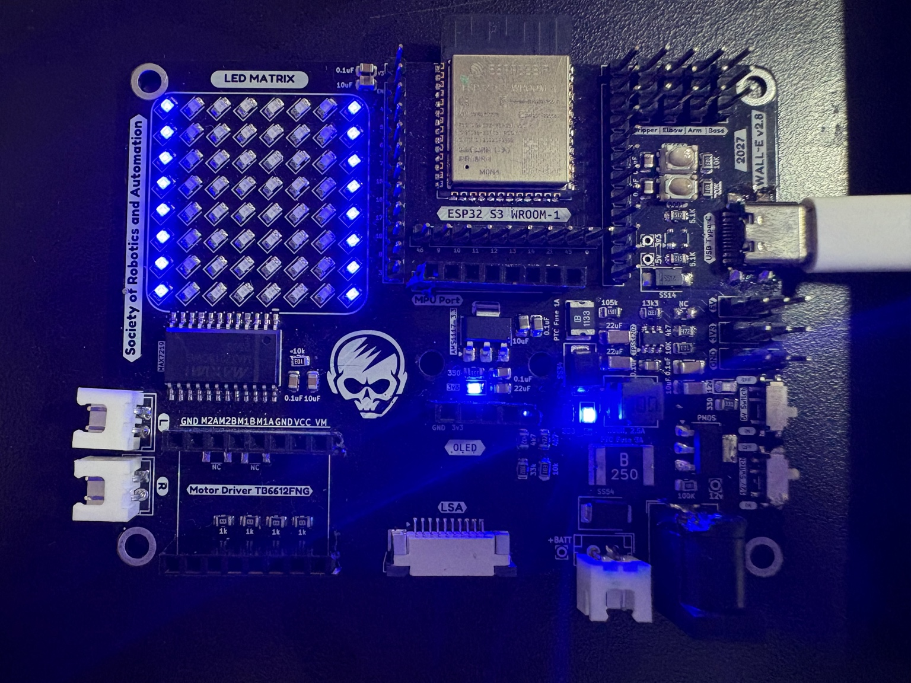
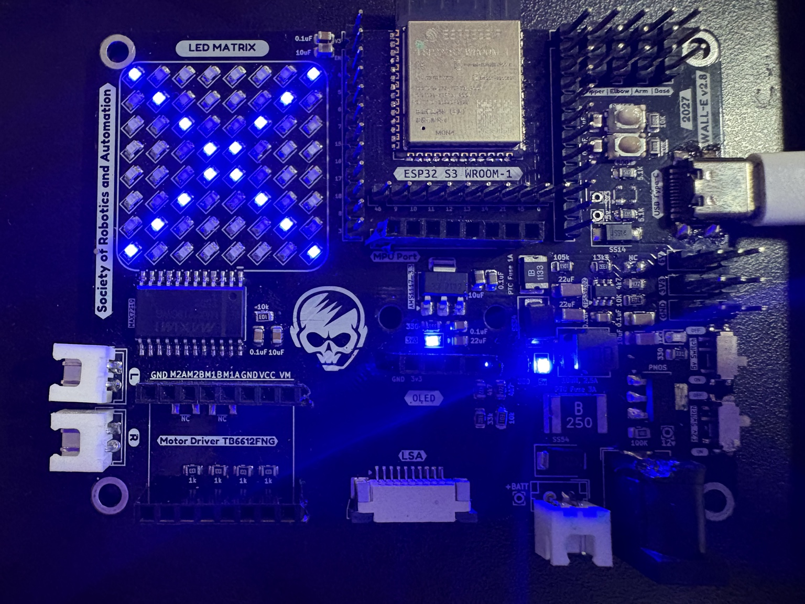
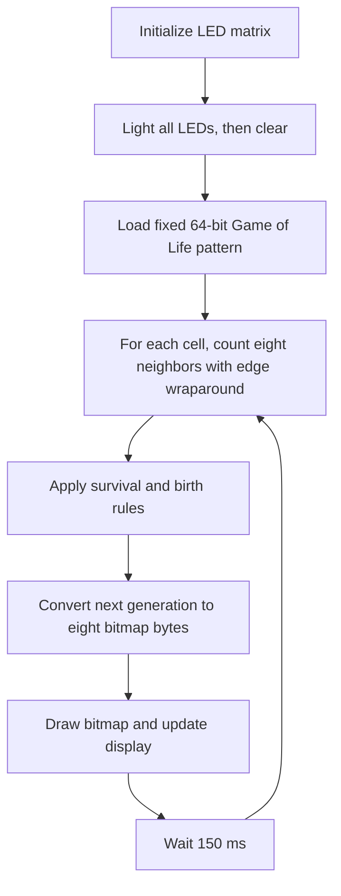

# LED Matrix — Conway's Game of Life

This example uses the SRA Board's **8 × 8 LED matrix**, controlled by a **MAX7219** driver, to display Conway's Game of Life. At startup, it briefly lights all 64 LEDs before animating successive generations from a fixed starting pattern.

## How the MAX7219 works

The MAX7219 drives and refreshes the LEDs for the ESP32. Instead of individually controlling every LED, the ESP32 sends a register address and a value to the MAX7219. The driver stores the pattern, scans the display, and controls its brightness.

The SRA Board connects the driver to the ESP32 through three signals (defined in [`pin_defs.h`](../components/sra-board-component/include/pin_defs.h)):

| Signal | Function |
| --- | --- |
| `DIN` | Serial data sent from the ESP32 |
| `CLK` | Clock used to shift in data bits |
| `LOAD` | Latches the received command into the selected register |

Each command is **16 bits**: an 8-bit register address followed by an 8-bit value. A few important MAX7219 registers are:

| Register address | Purpose | Value used by the driver |
| --- | --- | --- |
| `0x01`–`0x08` | LED data for the eight digit lines | One byte of on/off bits per line |
| `0x09` | Decode mode | `0x00`: use raw LED bits |
| `0x0A` | Intensity | `0x00`–`0x0F`: brightness control |
| `0x0B` | Scan limit | `0x07`: scan all eight lines |
| `0x0C` | Shutdown | `0x01`: normal display operation |
| `0x0F` | Display test | `0x00`: display test disabled |

`led_matrix_init()` configures these registers; application code should use the provided LED matrix API rather than send raw commands. See the [MAX7219 datasheet](https://www.analog.com/media/en/technical-documentation/data-sheets/MAX7219-MAX7221.pdf) for the full register descriptions.

## Representing LEDs with hexadecimal values

An 8 × 8 image can be represented as **eight bytes**, one byte per logical row. Within a row, `1` turns an LED on and `0` turns it off. Bit 7 is the **leftmost** LED and bit 0 the **rightmost**. For instance, `0x81` is `10000001` in binary, which lights the two LEDs at the ends of a row. Repeating `0x81` across all eight rows lights the two outer columns, as shown on the physical SRA Board below.



Here is **one complete example**: an X-shaped bitmap.

```c
led_matrix_t matrix;
ESP_ERROR_CHECK(led_matrix_init(&matrix));

uint8_t x_bitmap[LED_MATRIX_HEIGHT] = {
    0x81, // #......#
    0x42, // .#....#.
    0x24, // ..#..#..
    0x18, // ...##...
    0x18, // ...##...
    0x24, // ..#..#..
    0x42, // .#....#.
    0x81  // #......#
};

ESP_ERROR_CHECK(led_matrix_draw_bitmap(&matrix, x_bitmap));
ESP_ERROR_CHECK(led_matrix_show(&matrix));
```



`led_matrix_draw_bitmap()` copies the eight bytes into the in-memory framebuffer; `led_matrix_show()` sends the framebuffer to the physical display.

**Board-specific mapping:** In the SRA Board, the MAX7219 digit registers correspond to **physical columns**, while the API accepts **logical rows**. The driver transposes the bitmap when displaying it, so you should pass row data in normal top-to-bottom order—**do not transpose it yourself**. For example, at the register level, writing `0x80` to digit register `0x01` lights the top LED in the leftmost physical column.

For further API usage and examples, see the [`sra-board-component` LED matrix documentation](https://github.com/SRA-VJTI/sra-board-component/tree/main/examples/led_matrix). The complete driver interface is defined in [`led_matrix.h`](../components/sra-board-component/include/led_matrix.h).

## What this example does

The code in [`main/main.c`](main/main.c) runs the following algorithm:

1. Initialize the MAX7219-driven matrix with `led_matrix_init()`.
2. Light all 64 LEDs for **1,500 ms**, then clear the matrix for **200 ms**.
3. Set the initial Game of Life board to the fixed 64-bit value `0x84536184DB32C529`.
4. For every cell, count its eight neighbors, wrapping around the edges of the 8 × 8 grid.
5. Apply the rules: a live cell survives with **two or three** live neighbors; a dead cell becomes alive with **exactly three** live neighbors.
6. Encode the new board as eight bytes, call `led_matrix_draw_bitmap()` and `led_matrix_show()`, wait **150 ms**, and repeat from step 4.



The starting pattern is deterministic, not randomly generated at boot. See [Conway's Game of Life](https://en.wikipedia.org/wiki/Conway%27s_Game_of_Life) for background on the rules. For build and flashing instructions, use the [repository's installation guide](../Installations.md).
